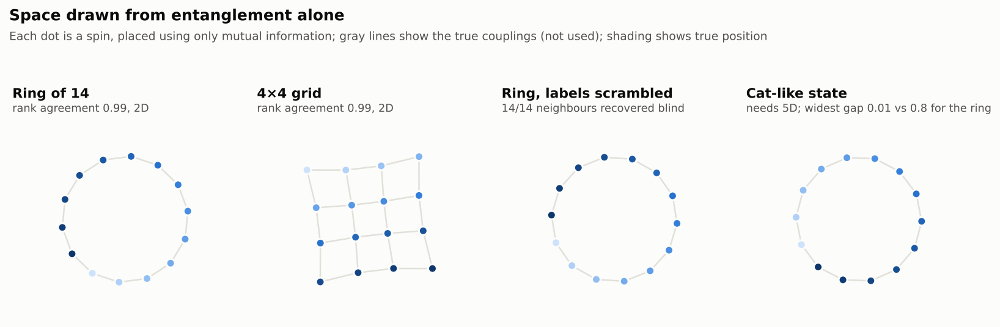

# the-web

An independent investigation of one idea:

> **Beneath space and time is a web of connection. Its structure sets both distance and how much entanglement is possible between any two parts, and quantum mechanics' limits are the geometry of that web.**

The idea grew out of a conversation that started with a misleading claim about "virtual photons" and ended somewhere testable ([how it developed](docs/origins.md)). This repo writes it down precisely, connects it to existing physics, and tests each piece numerically.

It's a working hypothesis, not a theory. Much of it restates known physics or existing research in a particular arrangement. The aim is to find out which parts hold, which are open, and which could fail.

## Start here

| | |
|---|---|
| [HYPOTHESIS.md](HYPOTHESIS.md) | The hypothesis (v0.3): postulates, status of each, what would count against it, version history |
| [docs/origins.md](docs/origins.md) | How the idea developed, step by step |
| [docs/literature.md](docs/literature.md) | Background reading with verified sources |
| [OPEN_QUESTIONS.md](OPEN_QUESTIONS.md) | What the hypothesis still has to answer |
| [LOG.md](LOG.md) | Research log |

## Findings so far

| # | Investigation | Question | Short answer |
|---|---|---|---|
| 01 | [Tsirelson geometry](investigations/01-tsirelson-geometry/) | Is the quantum limit 2√2 "whatever is geometrically possible"? | **Yes, for two-outcome correlations.** Arrows on a line give 2, arrows in a plane give 2√2 exactly, and geometry runs out at precisely that point. |
| 02 | [Capacity from structure](investigations/02-capacity-from-structure/) | Is entanglement capacity set by the web's shape? | **Yes, as a ceiling.** Never exceeded in 4,100 checks; follows pipe width. How full it gets depends on what's on the nodes. |
| 03 | [One web, two jobs](investigations/03-one-web-two-jobs/) | Does the same structure set distance and entanglement? Does the carving into nodes matter? | **Yes and yes.** Geometry redrawn from entanglement alone; the same links predict region entanglement; re-carving into far-apart nodes destroys the geometry. |
| 04 | [Finite configurations](investigations/04-finite-configurations/) | Which states could come from a web of links? | **Not cat states.** Graphs always obey monogamy of mutual information; GHZ-like states don't, but that part is fragile and a tiny nudge removes it. |



## Running it

Needs Python 3.10+ with numpy, scipy, networkx and matplotlib.

```bash
pip install -e ".[test]"        # or just: pip install numpy scipy networkx matplotlib pytest
python -m pytest -q              # 14 sanity checks
python investigations/01-tsirelson-geometry/run.py
python investigations/02-capacity-from-structure/run.py
python investigations/03-one-web-two-jobs/run.py
python investigations/04-finite-configurations/run.py
```

Each investigation writes its numbers to `results/summary.json` and its figures to `results/`. All runs are seeded, so results reproduce exactly. Total runtime is about 2 minutes.

## Layout

```
HYPOTHESIS.md          the hypothesis, versioned
OPEN_QUESTIONS.md      what's unresolved
LOG.md                 research log
docs/                  origins and literature
src/theweb/            shared tools
  quantum.py           entropies, mutual information, random states
  tensor_network.py    random tensor networks on graphs, min-cuts
  correlations.py      Bell correlations as geometry
  spin_models.py       spin Hamiltonians on any graph
  embedding.py         geometry from mutual information
  plotstyle.py         shared figure style
investigations/NN-*/   one folder per question: README (question, method, results), run.py, results/
tests/                 sanity checks for the tools
```

## Credit

The core ideas (a shared pre-spacetime base, connection having a cost, capacity determined by structure rather than a hard limit, and nodes being distinguished by a reader) came from the repo owner. Formalization, connections to the literature, and the numerical investigations were developed with Claude.
