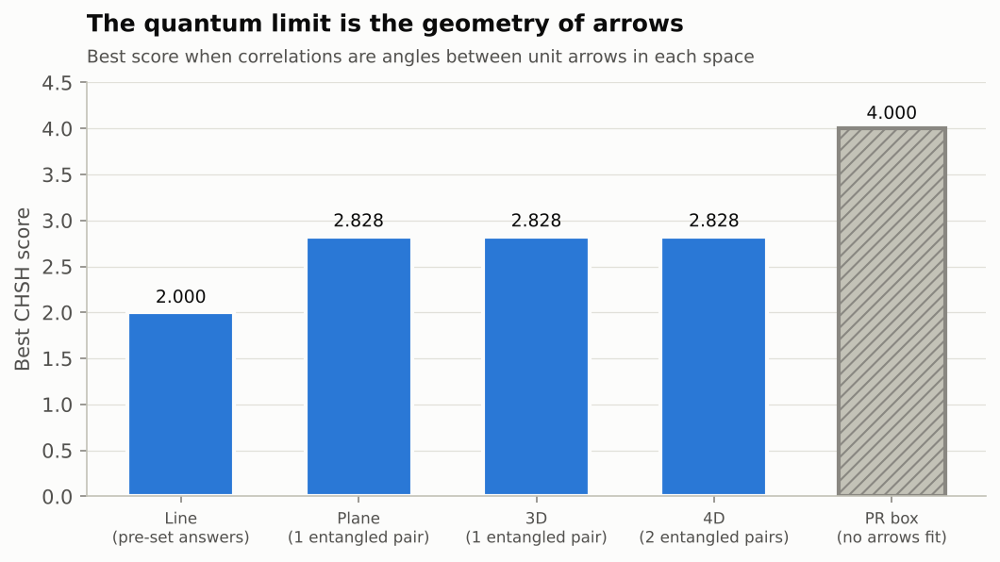
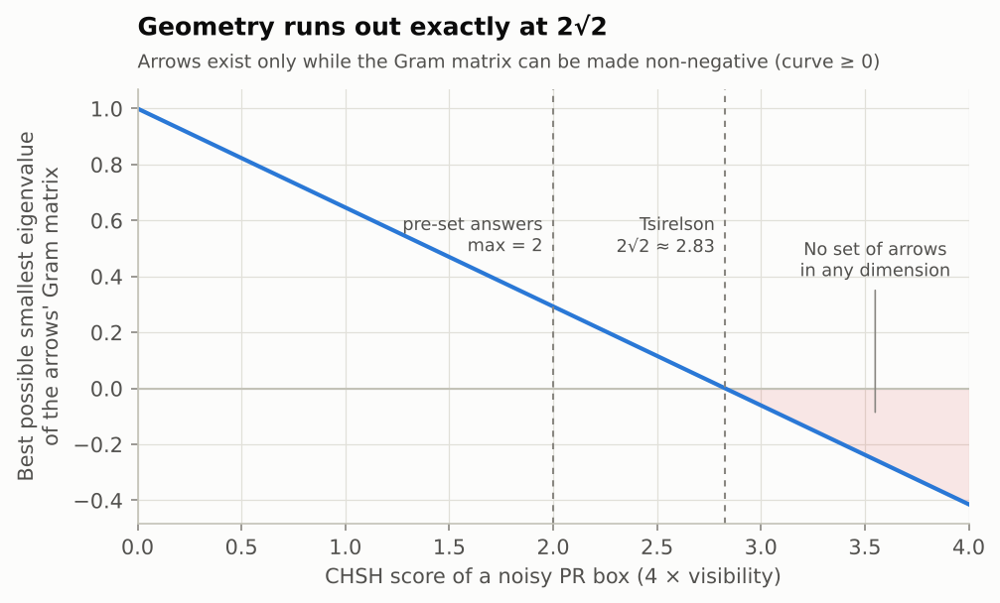
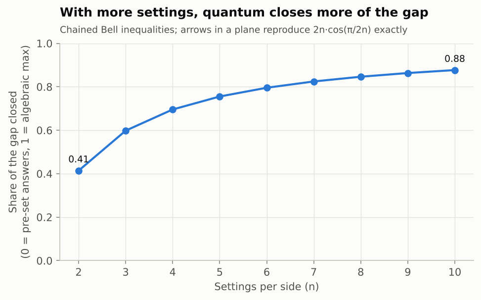
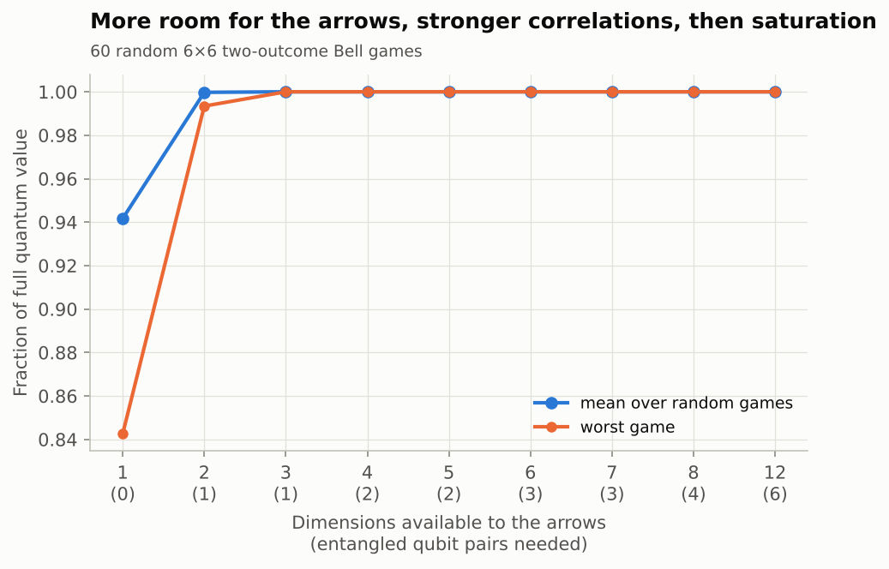

# Investigation 01: Is the quantum limit "whatever is geometrically possible"?

**Tests:** P3 (correlations are geometry). **Status:** done. **Run:** `python investigations/01-tsirelson-geometry/run.py` (about 1 minute).

## Question

In the CHSH Bell test, pre-set answers score at most 2, quantum mechanics at most 2√2 ≈ 2.83, and the math allows 4. Is the 2.83 limit an extra rule, or does it fall out of geometry?

## Method

Tsirelson's theorem says quantum correlations (for two-outcome measurements) are exactly the inner products of unit vectors: each measurement setting is an "arrow," and the correlation between two settings is the cosine of the angle between their arrows. So the question becomes: how high can the score go when the arrows live in a space of 1, 2, 3, ... dimensions?

- **E1.** Maximize the CHSH score over unit arrows in 1D, 2D, 3D and 4D. Turn the 2D arrows into an explicit quantum experiment (Tsirelson's construction) and check the score from the actual matrices. Check the parallelogram-law argument on 100,000 random arrow pairs.
- **E2.** Take a PR box (score 4) mixed with noise, and find the exact noise level where *no* set of arrows in *any* dimension can reproduce it (via the smallest eigenvalue of the arrows' Gram matrix).
- **E3.** Repeat for chained Bell tests with 2–10 settings per side and compare with the known formula 2n·cos(π/2n).
- **E4.** For 60 random 6×6 Bell games, ask how much "room" (dimensions, which correspond to entangled qubit pairs) the arrows need to reach the full quantum value.

## Results

| Check | Result |
|---|---|
| Arrows on a line (1D) | **2.000** = pre-set answers |
| Arrows in a plane (2D) | **2.828427…** = Tsirelson bound 2√2, to 15 digits |
| Arrows in 3D, 4D | 2.828427… (more room doesn't help) |
| Explicit quantum strategy built from the 2D arrows | 2.828427…, using **1 entangled pair** |
| Parallelogram law, 100k random pairs | holds to 3×10⁻¹⁵; largest sampled \|b₀+b₁\|+\|b₀−b₁\| = 2.8284271 |
| PR box | best Gram eigenvalue −0.414: **no arrows in any dimension** |
| Noise level where arrows stop existing | visibility 0.7071068 (expected 1/√2), i.e. **score 2.8284271** |
| Chained Bell, n = 2…10 | matches 2n·cos(π/2n) to 4×10⁻¹³; arrows in a plane suffice |
| Random 6×6 games | 1D reaches 94% of the quantum value on average; 2D 99.98%; 3D 100%. Quantum beats classical by 6% on average, 19% at most, well inside the Grothendieck limit (~1.78) |

## What this means for the hypothesis

**P3 holds for this class of correlations.** The quantum limit is not an extra rule. The jump from 2 to 2.83 is the jump from arrows that can only point forward or backward to arrows that can point anywhere in a plane. The cap at 2.83 is the parallelogram law. And the PR box's 4 is impossible because those correlations can't be drawn as arrows at all.

Two further points connect to the "capacity" idea:

- **Geometric room costs entanglement.** Arrows in d dimensions need ⌊d/2⌋ entangled qubit pairs to realize. E4 shows correlation strength rises with room and then saturates, often after just one pair.
- **The limit is exactly where the geometry runs out** (E2): not approximately, but at 1/√2 to seven digits.

**Caveat (important):** this is a known mathematical theorem (Tsirelson 1980), so it confirms P3 is consistent with established physics rather than discovering anything new. It also covers only two-outcome correlations between two parties. For more outcomes or parties, the "almost quantum" problem appears (see [OPEN_QUESTIONS.md](../../OPEN_QUESTIONS.md#1-does-web-geometry-pin-down-exactly-the-quantum-set)), and that's where P3 could genuinely fail.

