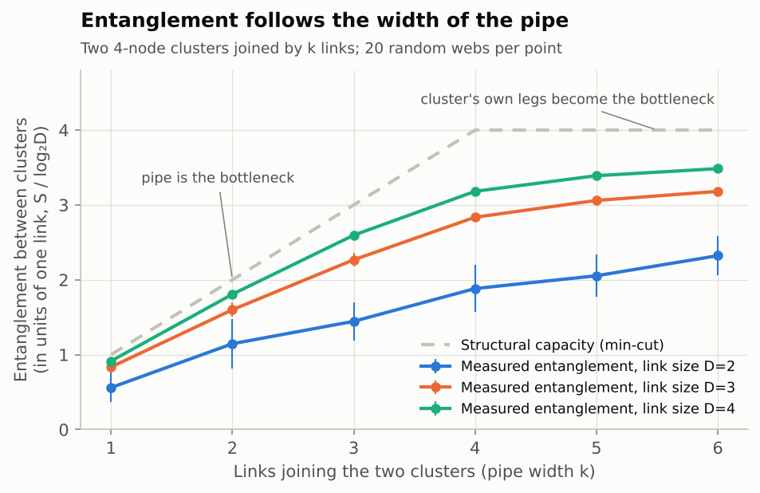
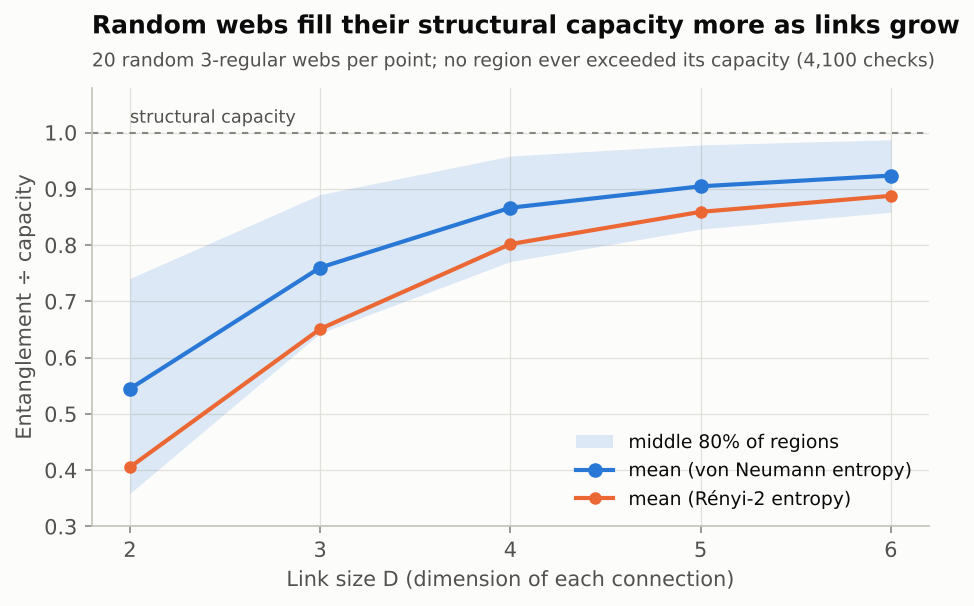
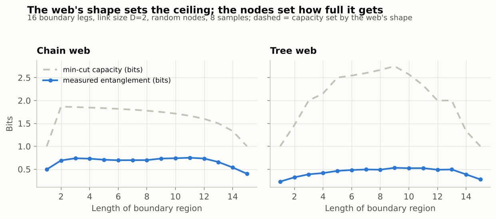

# Investigation 02: Is entanglement capacity set by the web's own structure?

**Tests:** P1 (structure-limited capacity). **Status:** done. **Run:** `python investigations/02-capacity-from-structure/run.py` (about 40 seconds).

## Question

If the web is a set of nodes joined by links, is the entanglement possible between two parts of it set purely by the shape of the web, the narrowest bottleneck between them?

## Method

Random tensor networks are the simplest precise "webs." Each node holds a random tensor, each link has a size D (the dimension of the connection), and the network's open "legs" carry a quantum state. For any boundary region, the **min-cut** is the fewest links you'd have to cut to separate it from the rest. A rigorous theorem says the region's entanglement can never exceed min-cut × log₂D bits. That's the "structural capacity."

- **E1. Pipe width.** Two 4-node clusters joined by k = 1…6 links. Measure the entanglement between the clusters for link sizes D = 2, 3, 4.
- **E2. How full does the capacity get?** 20 random 3-regular webs per link size (D = 2…6), 41 regions each: compare measured entanglement with capacity. Also count any violations of the bound.
- **E3. Shape sets the profile.** A chain web and a tree web with the same 16 legs: how does entanglement change with region length?

## Results

| Check | Result |
|---|---|
| Bound violations | **0 of 4,100** checks: no region ever exceeded its structural capacity |
| Pipe width (E1) | Entanglement rises with k while the pipe is the bottleneck, then levels off once the cluster's own 4 legs become the bottleneck, as the min-cut predicts |
| Fill vs link size (E2) | Average entanglement ÷ capacity: **0.54** (D=2), 0.76 (D=3), 0.87 (D=4), 0.90 (D=5), **0.92** (D=6) |
| Shape (E3) | Entanglement follows the min-cut profile of each shape (correlation 0.91 chain, 0.90 tree), but at D=2 it uses only 25–50% of capacity |

## What this means for the hypothesis

**P1 holds in these models, with an important refinement.** The structure sets a hard *ceiling*: entanglement can never exceed the narrowest cut through the web, and the ceiling responds exactly to the web's shape (pipe width, chain vs tree). But how close a region gets to its ceiling depends on what's on the nodes. Random nodes reach about half the ceiling with small links and over 90% with larger ones.

This echoes the car analogy from the conversation that started this project: the structural capacity is the "potential," always there mathematically, and actual entanglement approaches it without quite reaching it. The difference from the car is that the shortfall here isn't friction from outside. It comes from the nodes themselves.

The degenerate case is informative too: at k = 4 in E1, two different cuts tie (the pipe and the cluster's legs), and saturation dips. Competing bottlenecks waste capacity.

**Caveats:**
- The ceiling is a theorem about tensor networks, so it isn't news. What's tested here is how it plays out, and that it's the right *kind* of object for the hypothesis.
- Whether nature is a web of this kind is the open question. These are models, not observations.
