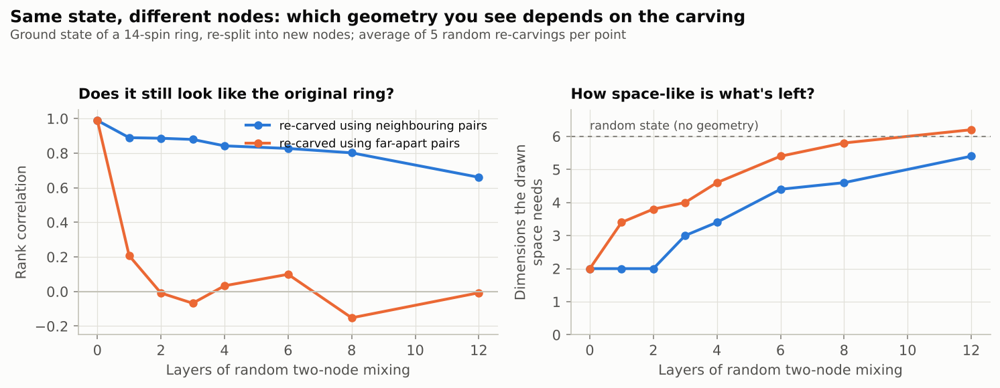
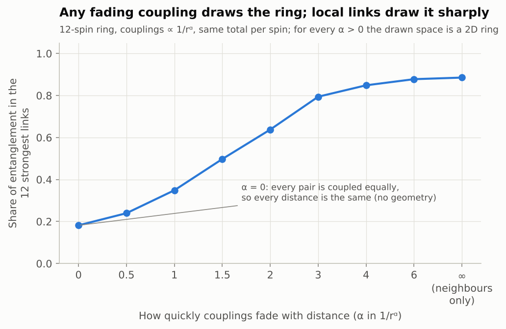
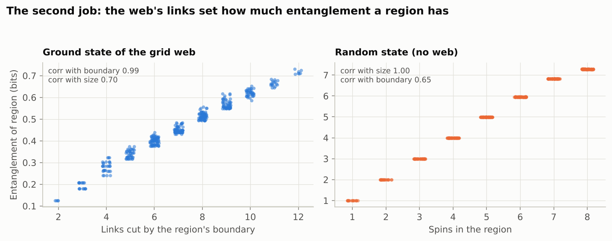

# Investigation 03: One web, two jobs

**Tests:** P4 (space is downstream), P5 (one web sets both distance and entanglement), and the node-distinction idea (nodes exist relative to a "reader"). **Status:** done. **Run:** `python investigations/03-one-web-two-jobs/run.py` (about 10 seconds).

## Question

Take quantum systems whose geometry we already know: spins on a ring or a grid, coupled to their neighbours. Using *only* the entanglement in their ground state, can we redraw the geometry? Does the same web also decide how much entanglement each region has? And does the geometry depend on how we carve the system into nodes?

## Method

Ground states of the transverse-field Ising model, computed exactly for 12–16 spins. For every pair of spins we compute the mutual information (how much they share), turn strong sharing into "close" and weak into "far" (distance = −log of relative mutual information, following Cao, Carroll & Michalakis 2017), and draw the result with multidimensional scaling. The true couplings are never shown to the reconstruction.

- **E1.** Ring of 14 (two phases), 4×4 grid, 4×4 torus. Compare drawn distances with true distances (rank correlation) and count dimensions needed.
- **E2.** States with no geometry: a GHZ cat state, a cat-like Ising state, and a random state.
- **E3.** Scramble the ring's labels and try to recover it blind.
- **E4. Re-carving.** Keep the same quantum state but split it into different "nodes," by mixing spins in pairs with random operations, either neighbouring pairs or far-apart pairs.
- **E5.** Couplings that fade with distance as 1/rᵅ, from α = 0 (everyone coupled equally) to α = ∞ (neighbours only).
- **E6. The second job.** 400 random regions of the 4×4 grid: does their entanglement follow the number of web links crossing their boundary, or their size? Compare with a random state.

## Results

| Check | Result |
|---|---|
| Ring of 14 (E1) | Rank agreement **0.99**, drawn as a **2D** ring |
| 4×4 grid (E1) | Rank agreement **0.99**, drawn as a flat **2D** grid |
| 4×4 torus (E1) | Rank agreement 0.92, needs **4D** (a torus needs 4 flat dimensions to draw without distortion) |
| GHZ state (E2) | Every pair shares exactly 1 bit. All distances are zero: everything is in the same place |
| Cat-like Ising state (E2) | The ordering survives, but all distances are within 0.01 of each other (vs 0.8 for the critical ring) and it needs 5D |
| Random state (E2) | Pairs share almost nothing; rank agreement 0.06; 6D |
| Scrambled labels (E3) | **14 of 14** neighbours recovered blind |
| Re-carving, neighbouring pairs (E4) | Geometry degrades slowly: rank agreement 0.89 after one layer, 0.66 after 12 |
| Re-carving, far-apart pairs (E4) | Original geometry gone after one layer (0.21, then ~0). Dimension needed climbs from 2 to 6 |
| Coupling range (E5) | Any α > 0 draws the ring in 2D; the share of entanglement on the strongest links rises from 0.24 (α=0.5) to 0.89 (neighbours only). At α = 0 all distances are equal: no geometry |
| Second job (E6) | Ground state: entanglement tracks **boundary links** (correlation 0.99) far more than size (0.70); about 0.05 bits per link, 0.007 per site. Random state: tracks **size** (0.995), 0.89 bits per site |

## What this means for the hypothesis

**P4 and P5 hold in these systems.** The same set of links (the couplings) does both jobs: it lets you redraw the right geometry from entanglement alone, and it predicts how much entanglement each region has (area law). A state with no web behind it (random) does neither.

**The node-distinction idea checks out, sharply.** The geometry isn't a property of the quantum state alone. It depends on how the state is carved into nodes. Re-carving with far-apart pairs destroys the original geometry in a single step, even though nothing about the underlying state "changed." Re-carving with neighbouring pairs mostly preserves it. The carving that shows a clean geometry is the one in which the couplings are local. That supports the idea in Zanardi, Lidar & Lloyd (2004) and Carroll & Singh (2021) that the right split into subsystems is picked out by which interactions are local, or which observables a reader can access.

**Cat states are the clearest non-geometric states.** In a GHZ state, every spin is equally connected to every other, so "distance" has no meaning. Investigation 04 shows these are also exactly the states whose entanglement can't come from any graph of links.

**Caveats:**
- Rank agreement alone can mislead: the cat-like Ising state still scores 0.99 because its tiny distance differences are ordered correctly. That's why dimension and spread are reported too.
- These are 12–16 spin systems with geometries chosen in advance. The reconstruction recovers a known geometry; it doesn't show geometry emerging where there was none.
- The distance formula is one choice among several (see open question 6).

## References

- Cao, Carroll & Michalakis (2017), *Space from Hilbert space: recovering geometry from bulk entanglement*, [arXiv:1606.08444](https://arxiv.org/abs/1606.08444)
- Zanardi, Lidar & Lloyd (2004), *Quantum tensor product structures are observable-induced*, Phys. Rev. Lett. 92, 060402, [arXiv:quant-ph/0308043](https://arxiv.org/abs/quant-ph/0308043)
- Carroll & Singh (2021), *Quantum mereology: factorizing Hilbert space into subsystems with quasiclassical dynamics*, Phys. Rev. D, [arXiv:2005.12938](https://arxiv.org/abs/2005.12938)
