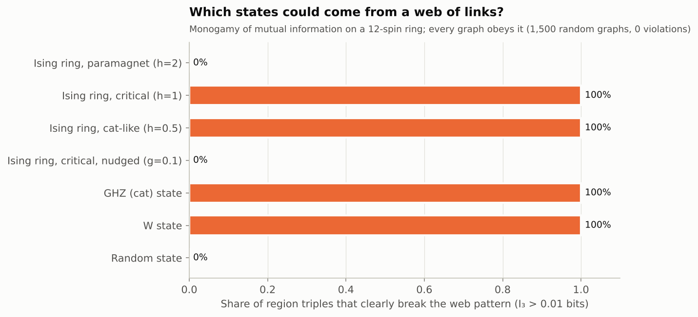
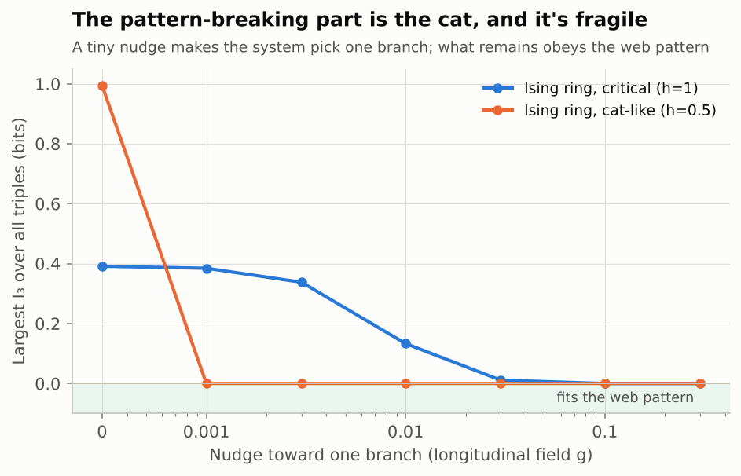

# Investigation 04: Finite nodes, finite configurations

**Tests:** the consequence of P1 that entanglement patterns are constrained by graph structure. Came from the observation that with a finite set of nodes there are only so many ways to connect them. **Status:** done. **Run:** `python investigations/04-finite-configurations/run.py` (about 10 seconds).

## Question

If every region's entanglement is the narrowest cut through a web of links, entropies can't take arbitrary values. Any graph obeys **monogamy of mutual information** (MMI; Hayden, Headrick & Maloney 2011):

> I₃(A:B:C) = I(A:B) + I(A:C) − I(A:BC) ≤ 0

Roughly: what A shares with B and what A shares with C can't overlap in the way some quantum states allow. Some quantum states break it. Which ones, and what does that say about the web?

## Method

- **E1.** 1,500 random weighted graphs: compute entropies as min-cuts and check MMI (should never fail).
- **E2.** Random tensor networks (quantum webs) with link sizes D = 2…5: 500 checks each.
- **E3.** 600 triples of disjoint regions on a 12-spin ring for: Ising ground states in three phases, a GHZ (cat) state, a W state, and a random state. A clear violation means I₃ > 0.01 bits.
- **E4.** For the Ising ring, add a tiny field that nudges the system to pick one of its two branches (up or down), and recheck.

## Results

| State | Clear violations | Largest I₃ (bits) |
|---|---|---|
| Random weighted graphs (min-cut entropies) | **0 of 1,500** | 1×10⁻¹⁵ (rounding) |
| Random quantum webs, D=2 | 0.6% (all tiny, < 0.002 links) | 0.001 |
| Random quantum webs, D ≥ 3 | **0%** | negative |
| Ising ring, paramagnet | 0% | 0.0002 |
| Ising ring, critical | **100%** | 0.39 |
| Ising ring, cat-like phase | **100%** | 0.99 |
| Ising ring, critical, nudged (g = 0.1) | **0%** | 0.00 |
| GHZ (cat) state | **100%** | 1.00 |
| W state | **100%** | 0.25 |
| Random state | 0% | negative |

**The nudge (E4):** for the cat-like phase, a field of just g = 0.001 removes every violation. For the critical ring, violations shrink steadily and are gone by g = 0.1.

## What this means for the hypothesis

**The "finite configurations" point gives the hypothesis a real constraint, and real states can fail it.** Entanglement from a web of links has to obey MMI. GHZ and W states don't, and neither do the Ising ground states that contain a cat-like superposition of "all up" and "all down."

**But the violation lives entirely in the cat part, and the cat is fragile.** Nudge the system so it picks one branch, and what remains obeys the web pattern. So there are two kinds of entanglement in these states:

1. **Web-like, local entanglement** that obeys graph rules and lets you draw a geometry (Investigation 03).
2. **Global cat correlations** that break graph rules, give no geometry, and vanish under the slightest disturbance.

This lines up with something physics already knows: macroscopic superpositions are extremely fragile, and in the real world the environment destroys them almost instantly (decoherence). One reading for the hypothesis: the web describes the robust, local part of entanglement, and cat-like correlations are a separate, fragile layer on top of it rather than part of the web's structure.

**Caveats:**
- MMI is one inequality. The full set of graph constraints (the "holographic entropy cone," Bao et al. 2015) has more for 5+ regions. Checking those is a natural next step.
- Random quantum webs at small D occasionally break MMI slightly. So "a web of quantum links" and "a graph with cut capacities" are not the same thing at small link sizes.
- Labs routinely make GHZ states (IBM reported 120 qubits in 2025). They're real, so the hypothesis can't say they're impossible, only that they aren't web-like.

## References

- Hayden, Headrick & Maloney, *Holographic mutual information is monogamous*, Phys. Rev. D 87, 046003 (2013), [arXiv:1107.2940](https://arxiv.org/abs/1107.2940) (posted 2011)
- Bao, Nezami, Ooguri, Stoica, Sully & Walter (2015), *The holographic entropy cone*, JHEP, [arXiv:1505.07839](https://arxiv.org/abs/1505.07839)
- Javadi-Abhari et al. (2025), *Big cats: entanglement in 120 qubits and beyond*, [arXiv:2510.09520](https://arxiv.org/abs/2510.09520)
